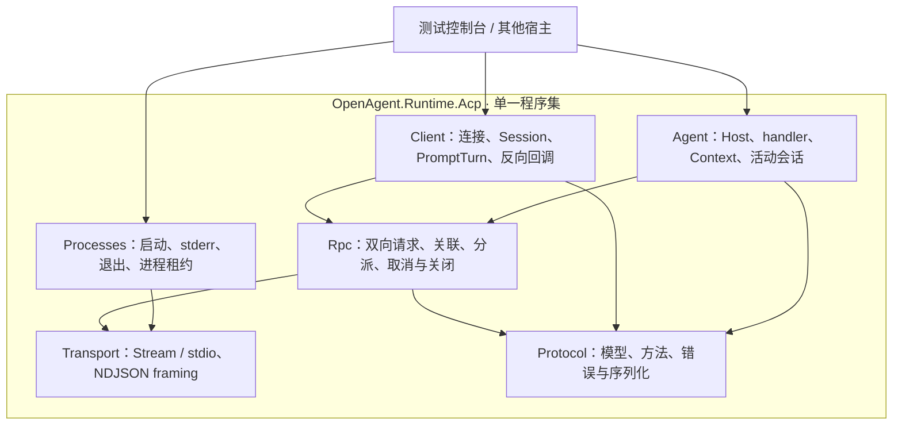

# C# ACP SDK 单包架构设计

> v0.3 · 2026-10-16。按用户要求采用单项目、单程序集、单 NuGet 包 `OpenAgent.Runtime.Acp`，落在 `Backend/src/OpenAgent.Runtime.Acp`。内部按职责分文件夹，不再采用五包方案。物理结构见 [DIRECTORY.md](./DIRECTORY.md)。

## 1. 架构原则

- 单包同时包含 Client、Agent、进程接入及协议基础设施；使用者只需引用一个 SDK。
- 模块是代码组织边界，不是发布单元；公共 API 保持精简，调度器/请求表等实现使用 internal。
- SDK 只负责协议与生命周期；实际推理、持久化、审批 UI、文件授权及沙箱由宿主实现。
- SDK、自动化测试、测试控制台同步演进。控制台消费公共 API，不复制传输或 RPC 实现。

## 2. 项目依赖和内部模块

工程依赖为：测试控制台 → SDK；测试工程 → SDK + 测试控制台。SDK 不引用其他 OpenAgent 模块，不依赖测试/控制台；三个工程一起纳入主解决方案。

下图表示**同一 SDK 内部**的职责依赖，不是项目或包引用：

| 内部模块 | 组件与责任 | 约束 |
|---|---|---|
| Protocol | 生成 DTO、RpcId、方法描述、错误、STJ context 与 wire 校验 | 不做 IO，不引用 Client/Agent |
| Transport | IAcpTransport、AcpStreamTransport、字节 framing、消息上限 | 一次一个完整消息体；不解析业务或执行 JSON-RPC |
| Rpc | 共享 RpcConnection、入/出站请求表、dispatcher、writer、连接生命周期 | 不认识平台业务；读取不等待长 handler |
| Client | ClientConnection、协商、Session、PromptTurn、更新路由和反向 handler | 低层保持 wire，高层提供会话便捷 API |
| Agent | AgentHost/Connection、必需与可选 handler、Context、活跃会话 | 只管理活动对象；业务历史由宿主保存 |
| Processes | Launcher、ProcessLease、stdio transport、stderr 和退出信息 | 不隐式 initialize，不自动安装 Agent |
| Diagnostics / Extensions | 脱敏诊断、ActivitySource/Meter、必要注册扩展 | 不绑定 exporter；不要求 DI/ASP.NET |

所有名称使用 `OpenAgent.Runtime.Acp.*`。目录与文件不必沿用 Demo；Protocol/Rpc/Transport 不引用上层，Client 与 Agent 不互相引用。跨模块复用放对应基础模块，不增设 Common 大目录。

## 3. 双向消息处理

1. reader 持续读取完整消息并校验 envelope；response 关联出站 pending，request 分派到独立任务，notification 走有序路由。
2. 入站和出站请求表分开；对端 ID 与本方 ID 可以相同。缺失 ID 与 null ID 不混淆。
3. prompt 可以等待反向权限/文件/终端调用，读取仍继续处理对应响应、取消及其他会话。模式/配置修改不排在长 prompt 后面。
4. writer 串行发送完整帧；普通调用配额耗尽不能阻塞控制路径。最终响应不能越过该轮已提交的更新。
5. 同会话通知按接收顺序入队，再完成 PromptTurn；完成表示入队完成，不表示 UI 已处理。跨会话可并发。
6. new/load/resume 响应前的通知按 sessionId 有界缓存，绑定后交 Session；未能绑定的事件可观测，不误投其他会话。
7. 队列溢出显式故障，不丢片段、不无限阻塞读取。EOF/故障让所有 pending 和 handler 收敛，不自动重发有副作用的请求。

RPC 引擎通过相同探针比较 StreamJsonRpc 与自有实现后确定；底层依赖不出现在公共 API。单包不等于单个巨大 Connection 类。

## 4. 能力与资源归属

| 拥有者 | 资源 | 结束规则 |
|---|---|---|
| Connection | transport、pending、调度任务、协商结果 | Dispose 幂等；统一关闭路径；LeaveOpen 明确流归属 |
| Client Session | 更新队列、早到通知、PromptTurn | 默认一会话一轮，冲突立即失败；关闭不杀共享进程 |
| Agent Host | 活跃 session、执行轮次和 Context | 关闭取消活跃任务；不删除宿主持久化历史 |
| 交互注册表 | 权限及 elicitation | 一次性回复；关闭时取消；关联原 connection/session |
| 宿主 handler | 文件访问、terminalId、执行策略 | 按 session 授权与回收；无 handler 不声明对应能力 |
| ProcessLease | 所拥有的子进程、stderr、退出信息 | 只回收自己启动/拥有的进程，不随单个 session 结束 |

能力由已注册 handler 与宿主启用项共同生成并校验；接口/类型存在不表示能力已经启用。缺少权限 handler 时默认 cancelled。取消已发送与远端停止已确认分别表达，详细行为及默认配额沿用主规格。

## 5. 生成与测试边界

固定官方稳定 schema/meta 的提交和哈希，在构建期生成模型及序列化元数据；生成结果与手写 converter 分离。SDK 运行时不下载 schema。生成器属于开发工具，不形成第二个 SDK 包。

自动化测试集中在 `OpenAgent.Runtime.Acp.Tests`，按功能域分组；通过公共 API 验证行为。控制台提供相同功能的可重现场景，并由测试启动其真实进程检查退出码和输出。核心不引用控制台或 fake Agent。

未来实验功能使用显式命名空间、开关和独立状态机；当前不实现 v2/HTTP/WS，不因逻辑分层增加发布包。具体功能顺序与三类同步交付规则由 IMPLEMENTATION.md 定义。

## 6. 当前 Demo 与平台关系

旧 Demo 只作为行为回归参考，不能把单出站请求循环直接当成可重入 RpcConnection。其实现逐项被 SDK 公共 API 替换后再退役；删除前核对测试、文档与启动入口，避免同时维护两套正式实现。

SDK 不把 ACP DTO 放进平台 Contracts。平台执行链的身份、会话映射、授权、隔离、审计及存储仍由平台拥有；平台适配作为独立后续任务定义，不能让 Application 反向引用具体执行实现。
